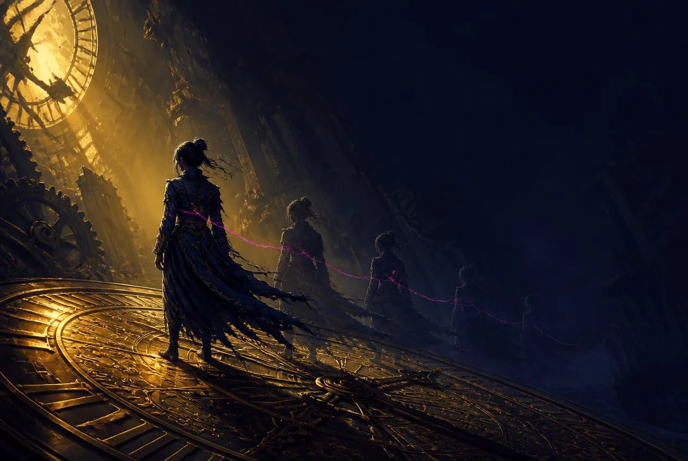
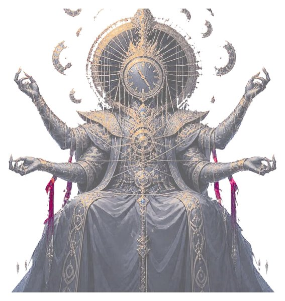
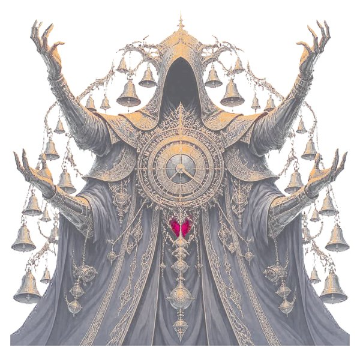
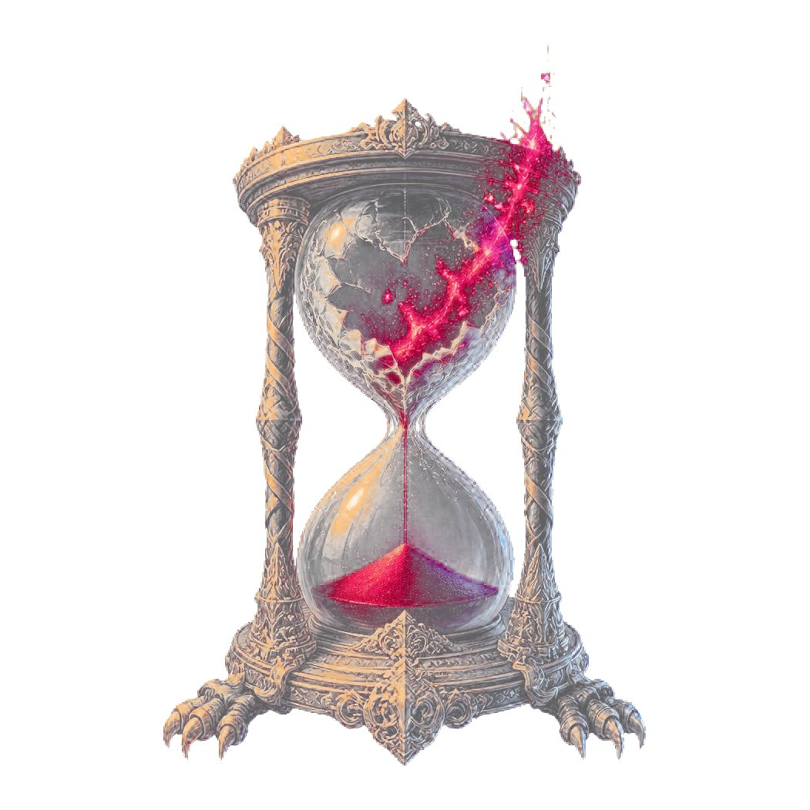

<p align="center">
  
</p>

<h1 align="center">回响 · ECHOES</h1>

<p align="center">一款浏览器上的策略卡牌 Roguelike</p>

一款浏览器上的策略卡牌 Roguelike。你打出的牌不会消失，它会在接下来的回合里一遍遍重演。

## 美术

<p align="center">
  
  
  
  
</p>

## 核心机制：回响时间轨

战场中央有一条四格时间轨，分敌我两条泳道。

- 打出的**织牌**落在 T+1 格，立即按 100% 结算一次，并留在轨上
- 每个回合开始，轨上条目按当前格位系数再次触发：T+1 为 100%，T+2 为 70%，T+3 为 45%，T+4 为 25%，数值向下取整
- 回合结束时全轨右移一格，移出末位的牌进入弃牌堆
- 轨道只有四格。轨满时再打织牌会把最旧的条目挤出去，**被挤出的牌移出本场战斗，不会回到弃牌堆**

由此长出三类牌：

| 类型 | 作用 |
|---|---|
| 织 | 进入时间轨铺垫，一张 5 点伤害的牌走完四格总共打出 11 点 |
| 引 | 把轨上条目尚未兑现的回响一次性清算，兑换效率六成，随后清空这些条目 |
| 扰 | 推移、交换、复制、冻结轨上条目，也能作用于敌方意图 |

敌人的攻击意图挂在同一条轨的另一侧，每回合右移，移出末位时落地。你可以把它往回推、抢先引爆、或者偷到自己的泳道上反打回去。堵死敌轨不能免除压力——意图会转为蓄力，之后一次性还给你。

单卡效率在每回合只打一张时最高，总输出随出牌数上升但伴随牌组损耗。克制换效率，倾泻换节奏。

## 进程

三幕分支地图，节点包含遭遇、精英、异象、残市、篝火与守时者。地图可以按住拖动平移，松手带惯性。

31 种敌人分杂兵、精英与守时者三档，各自有明确的战术身份：塞满敌轨让你无从干预的、只给一回合反应窗口的爆发型、不优先集火就滚雪球的护卫、以及往你弃牌堆里塞诅咒的骚扰型。带 ⊘ 的意图不可延后也不可冻结；守时者的核心大招还会挂在靠前的格位上，给你数个回合准备，但只能硬接。

113 张卡分织、引、扰三类，32 件遗物直接改写时间轨规则本身——衰减曲线的形状、条目的结算次数上限、被挤出的牌是否还能回收。
20 件装备分兵械、护甲、饰物、核心四槽，同槽相互顶替，每回合按钩子结算。
30 个异象里既有代价明确的抉择，也有宝箱怪、魔法馈赠与撞见就算的幸运发现。

其中 110 张卡各自还有另外的写法，开局按种子抽定一版，整局不变，重开才重新抽。立绘、名字与类别不随版本改变，所以同一张画在任何版本下都说得通。

倒下不直接判负。可以付出 30 时砂把当前节点从进入前的状态重走一遍，每个节点最多 3 次，用尽或主动收手才算这一局结束。玩家护甲在回合开始时保留一半；敌方护甲在其行动前清零。

## 操作

- 拖动手牌到敌人身上打出攻击类牌
- 拖动扰牌到时间轨的格位上，可放置的格位会高亮
- 灰色卡牌为当前不可打出，拖动时会给出拒绝反馈
- 轨上条目显示的数字是它**下一次**回响的实际产出，与结算完全一致
- 地图上点「牌组」「遗物」「装备」分别查看整副牌、已有遗物与四个槽位
- 战斗中点牌堆计数查看抽牌堆、弃牌堆与已烧毁的牌
- 手册里双击任意条目放大查看，未遭遇过的内容以问号占位

## 运行

```bash
npm install
npm run dev      # 开发服务器
npm run build    # 产出静态站点到 dist
npm test         # 引擎规则测试
```

产物是纯静态文件，无后端依赖。

## 素材管线

`npm run art` 按 `tools/artgen/manifest.mjs` 批量生成图像并做后处理：绿幕抠像、去溢色、裁剪对齐、缩放、编码为 WebP。原始图保留在各分类的 `raw/` 目录下，不参与构建。接口地址与密钥从 `.env.local` 读取。

音效由 Web Audio 实时合成，不加载任何文件。回响音效的音高随格位系数下移，衰减在听觉上可直接分辨。

音乐是预先渲染的曲目，`npm run audio` 按指定码率重编码为交付格式，源文件留在 `assets/audio/source/`，不参与构建。
`npm run pack` 用保留的原始图重新导出交付用的 WebP，改动清单里的尺寸或质量后跑一次即可，不必重新生成画面。

## 目录

```
src/engine/     游戏规则，纯函数，无 DOM 与计时器
src/ui/         界面渲染与输入
src/fx/         画布粒子与屏幕效果
src/audio/      音效合成
src/content/    卡牌、敌人、遗物、装备、事件定义
src/content/variants/  卡牌的另几种写法
assets/data/    引擎读取的数值表
tools/          素材管线与截图脚本
design/gdd/     设计文档
```

引擎与界面完全分离：状态进，新状态出，不含随机源之外的不确定性。相同种子与相同操作序列产生逐字节相同的结果。
